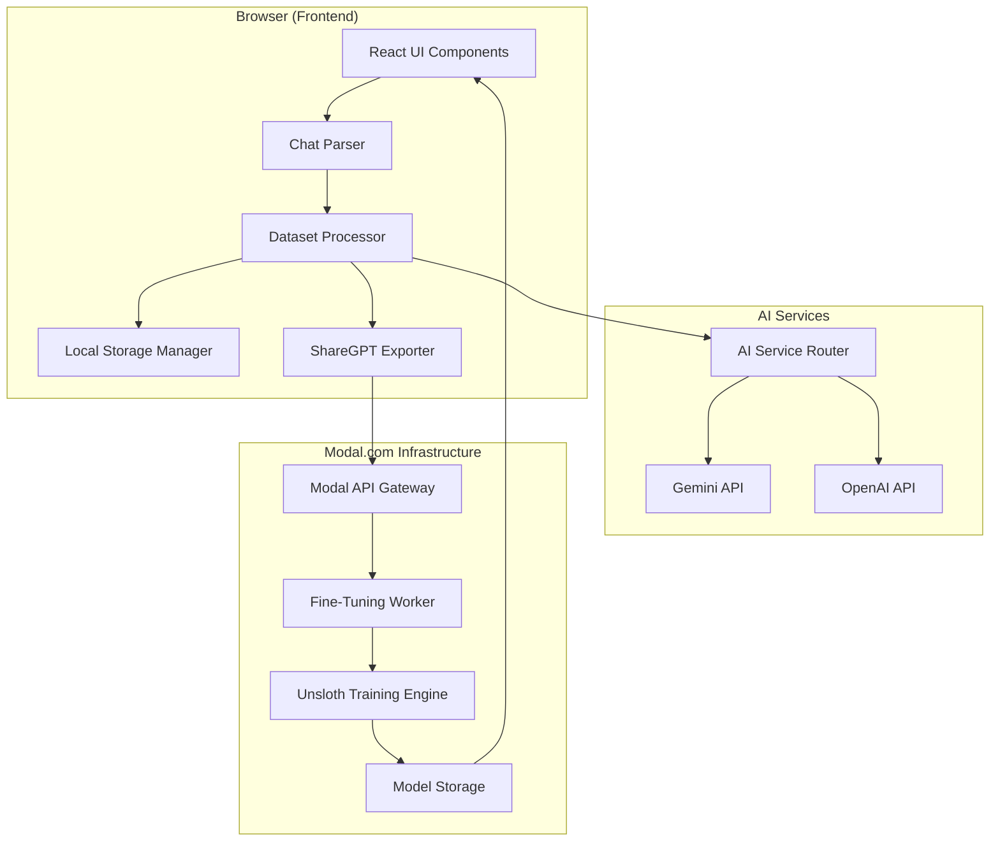
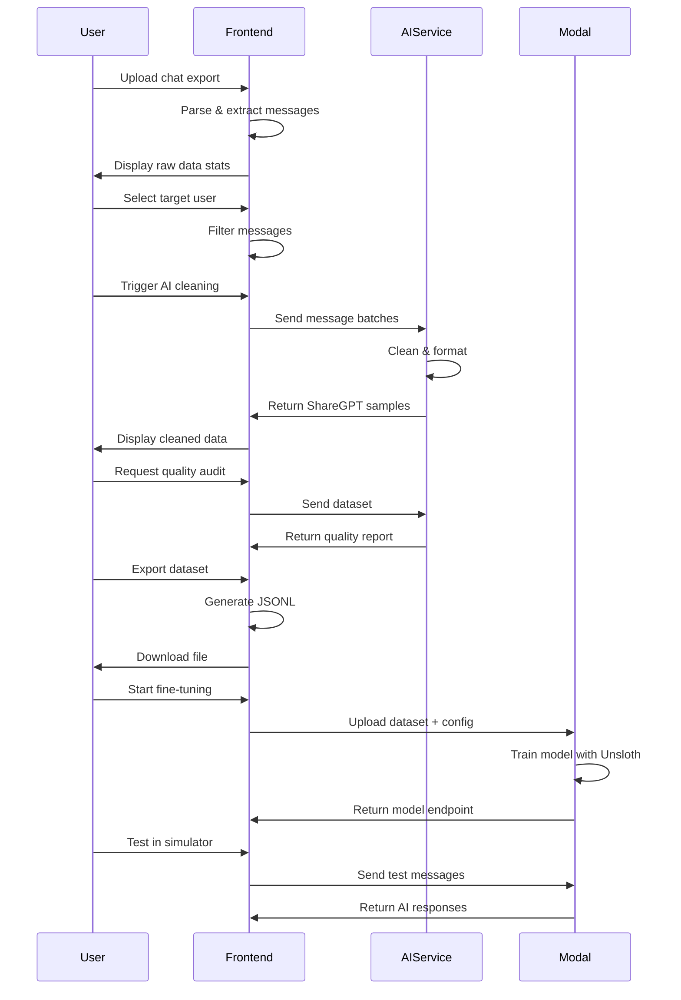

# Design Document: AI Clone Studio

## Overview

AI Clone Studio is a full-stack web application that transforms personal chat histories into fine-tuned AI clones. The system consists of three main layers:

1. **Frontend Layer** (React SPA): Handles data import, preprocessing, visualization, and user interaction
2. **AI Processing Layer** (LLM APIs): Performs intelligent data cleaning, analysis, and quality validation
3. **Training Layer** (Modal.com + Unsloth): Executes GPU-accelerated model fine-tuning

The architecture follows a client-heavy design where most data processing happens in the browser, minimizing backend infrastructure while leveraging cloud AI services for compute-intensive tasks. This approach provides users with immediate feedback, data privacy (local processing), and cost-effective scaling.

### Key Design Principles

- **Privacy-First**: Raw chat data never leaves the user's browser until explicitly exported
- **Progressive Enhancement**: Core features work offline; AI features require API access
- **Modular Pipeline**: Each processing stage is independent and reversible
- **Cost Transparency**: Users see estimated API costs before triggering AI operations
- **Fail-Safe**: All operations support cancellation and state recovery

## Architecture

### System Architecture Diagram



### Component Interaction Flow



## Components and Interfaces

### 1. Chat Parser Component

**Responsibility**: Parse chat export files into normalized message objects.

**Interface**:
```typescript
interface Message {
  id: string;
  timestamp: Date;
  sender: string;
  text: string;
  type: 'text' | 'system' | 'media';
  metadata?: Record<string, any>;
}

interface ParseResult {
  messages: Message[];
  participants: string[];
  dateRange: { start: Date; end: Date };
  platform: 'telegram' | 'whatsapp';
}

class ChatParser {
  parseTelegram(jsonContent: string): ParseResult;
  parseWhatsApp(txtContent: string): ParseResult;
  detectFormat(content: string): 'telegram' | 'whatsapp' | 'unknown';
}
```

**Implementation Notes**:
- Telegram parser handles nested JSON structure with message arrays
- WhatsApp parser uses regex to extract timestamp, sender, and text from each line
- System messages (joins, leaves, name changes) are tagged but not filtered at this stage
- Media messages are preserved with metadata but text content is marked as `[Media]`

### 2. Dataset Processor Component

**Responsibility**: Apply filters, transformations, and quality controls to message data.

**Interface**:
```typescript
interface FilterConfig {
  minMessageLength: number;
  mergeBurstMessages: boolean;
  filterLazyResponses: boolean;
  lazyPatterns: string[];
  enableIdentityGuard: boolean;
}

interface ProcessingStats {
  totalMessages: number;
  filteredMessages: number;
  mergedBursts: number;
  finalSampleCount: number;
}

class DatasetProcessor {
  constructor(messages: Message[], targetUser: string);
  
  applyFilters(config: FilterConfig): void;
  mergeBurstMessages(): void;
  filterByLength(minLength: number): void;
  filterLazyResponses(patterns: string[]): void;
  validateIdentity(): void;
  
  getStats(): ProcessingStats;
  getProcessedMessages(): Message[];
}
```

**Implementation Notes**:
- Burst merging combines consecutive messages from same sender within 5-minute window
- Lazy response detection uses both exact matches and regex patterns
- Identity guard compares sender field against target user (case-insensitive)
- All filters are non-destructive; original data is preserved in local storage

### 3. AI Service Router

**Responsibility**: Abstract AI provider differences and handle API communication.

**Interface**:
```typescript
interface AIConfig {
  provider: 'gemini' | 'openai';
  apiKey: string;
  model: string;
  batchSize: number;
}

interface CleaningRequest {
  messages: Message[];
  targetUser: string;
  systemPrompt: string;
}

interface CleaningResponse {
  samples: ShareGPTConversation[];
  tokensUsed: number;
  cost: number;
}

interface AnalysisResponse {
  tone: string;
  vocabularyLevel: string;
  humorStyle: string;
  typicalTopics: string[];
  uniquePhrases: string[];
  confidence: number;
}

class AIServiceRouter {
  constructor(config: AIConfig);
  
  async cleanMessages(request: CleaningRequest): Promise<CleaningResponse>;
  async analyzeStyle(messages: Message[]): Promise<AnalysisResponse>;
  async auditQuality(dataset: ShareGPTConversation[]): Promise<QualityReport>;
  
  estimateCost(messageCount: number): number;
}
```

**Implementation Notes**:
- Gemini uses `gemini-1.5-flash` for cost efficiency; OpenAI uses `gpt-4o-mini`
- Batch size defaults to 50 messages per API call to balance speed and context
- System prompt instructs LLM to: remove spam, format as ShareGPT, preserve personality
- Retry logic implements exponential backoff: 1s, 2s, 4s delays
- Cost estimation uses current API pricing: Gemini $0.075/1M tokens, OpenAI $0.15/1M tokens

### 4. ShareGPT Exporter

**Responsibility**: Convert processed messages into ShareGPT JSONL format.

**Interface**:
```typescript
interface ShareGPTMessage {
  from: 'human' | 'assistant';
  value: string;
}

interface ShareGPTConversation {
  conversations: ShareGPTMessage[];
}

interface ExportMetadata {
  dataset_name: string;
  target_user: string;
  creation_date: string;
  total_samples: number;
  platform: string;
  filters_applied: FilterConfig;
}

class ShareGPTExporter {
  constructor(messages: Message[], targetUser: string);
  
  convertToShareGPT(): ShareGPTConversation[];
  generateJSONL(): string;
  addMetadata(metadata: ExportMetadata): void;
  downloadFile(filename: string): void;
}
```

**Implementation Notes**:
- Conversations are created by pairing non-target messages (human) with target messages (assistant)
- Each conversation maintains chronological order
- Metadata is added as a comment line at the start of JSONL file
- Filename format: `{targetUser}_clone_dataset_{YYYYMMDD_HHMMSS}.jsonl`

### 5. Modal.com Integration Client

**Responsibility**: Communicate with Modal.com API for model training.

**Interface**:
```typescript
interface TrainingConfig {
  baseModel: 'llama-3-8b' | 'mistral-7b' | 'qwen-7b';
  loraRank: number;
  loraAlpha: number;
  learningRate: number;
  epochs: number;
  batchSize: number;
}

interface TrainingJob {
  jobId: string;
  status: 'queued' | 'running' | 'completed' | 'failed';
  progress: number;
  logs: string[];
  modelEndpoint?: string;
}

class ModalClient {
  constructor(apiKey: string);
  
  async uploadDataset(file: File): Promise<string>;
  async startTraining(datasetId: string, config: TrainingConfig): Promise<string>;
  async getJobStatus(jobId: string): Promise<TrainingJob>;
  async cancelJob(jobId: string): Promise<void>;
  async downloadModel(jobId: string): Promise<Blob>;
}
```

**Implementation Notes**:
- Dataset upload uses Modal's storage API with multipart upload for large files
- Training job is a Modal function that spawns a GPU container with Unsloth
- Status polling happens every 5 seconds during training
- Model endpoint is a Modal web endpoint that serves the fine-tuned model
- Default config: LoRA rank=16, alpha=32, LR=2e-4, epochs=3

### 6. Clone Simulator Component

**Responsibility**: Provide chat interface for testing trained AI clones.

**Interface**:
```typescript
interface SimulatorMessage {
  role: 'user' | 'assistant';
  content: string;
  timestamp: Date;
}

interface ModelInfo {
  baseModel: string;
  finetuningDate: Date;
  datasetSize: number;
  endpoint: string;
}

class CloneSimulator {
  constructor(modelInfo: ModelInfo);
  
  async sendMessage(content: string): Promise<string>;
  getConversationHistory(): SimulatorMessage[];
  resetConversation(): void;
  setSystemPrompt(prompt: string): void;
}
```

**Implementation Notes**:
- Conversation history is maintained in component state (max 50 messages)
- System prompt can be customized to adjust clone behavior
- API calls to model endpoint include full conversation context
- Streaming responses are supported for better UX
- Default system prompt: "You are {targetUser}. Respond naturally in their style."

### 7. Local Storage Manager

**Responsibility**: Persist application state and datasets in browser storage.

**Interface**:
```typescript
interface SavedDataset {
  id: string;
  name: string;
  createdAt: Date;
  updatedAt: Date;
  messageCount: number;
  targetUser: string;
  messages: Message[];
  filterConfig: FilterConfig;
}

class StorageManager {
  saveDataset(dataset: SavedDataset): void;
  loadDataset(id: string): SavedDataset | null;
  listDatasets(): SavedDataset[];
  deleteDataset(id: string): void;
  getStorageUsage(): { used: number; limit: number };
  clearAll(): void;
}
```

**Implementation Notes**:
- Uses IndexedDB for large datasets (>5MB), localStorage for small data
- Implements LRU eviction when approaching 50MB limit
- Datasets are compressed using LZ-string before storage
- Settings and API keys are stored separately with encryption (Web Crypto API)

## Data Models

### Core Data Structures

```typescript
// Raw message from parser
interface Message {
  id: string;                    // UUID v4
  timestamp: Date;               // ISO 8601
  sender: string;                // Display name from chat
  text: string;                  // Message content
  type: 'text' | 'system' | 'media';
  metadata?: {
    platform?: string;
    replyTo?: string;
    edited?: boolean;
    forwarded?: boolean;
  };
}

// Processed conversation for training
interface ShareGPTConversation {
  conversations: Array<{
    from: 'human' | 'assistant';
    value: string;
  }>;
}

// Quality audit results
interface QualityReport {
  score: number;                 // 0-100
  sampleCount: number;
  avgMessageLength: number;
  conversationDiversity: number; // Unique conversation patterns
  roleBalance: number;           // Ratio of human/assistant messages
  warnings: string[];
  recommendations: string[];
}

// Training job state
interface TrainingJob {
  jobId: string;
  status: 'queued' | 'running' | 'completed' | 'failed';
  progress: number;              // 0-100
  startTime?: Date;
  endTime?: Date;
  config: TrainingConfig;
  logs: Array<{
    timestamp: Date;
    level: 'info' | 'warning' | 'error';
    message: string;
  }>;
  metrics?: {
    loss: number;
    evalLoss: number;
    perplexity: number;
  };
  modelEndpoint?: string;
  error?: string;
}
```

### State Management

The application uses React Context API for global state management:

```typescript
interface AppState {
  // Data pipeline state
  rawMessages: Message[];
  processedMessages: Message[];
  targetUser: string | null;
  filterConfig: FilterConfig;
  
  // AI processing state
  aiConfig: AIConfig;
  cleaningProgress: number;
  cleanedSamples: ShareGPTConversation[];
  styleAnalysis: AnalysisResponse | null;
  qualityReport: QualityReport | null;
  
  // Training state
  trainingJobs: TrainingJob[];
  activeJobId: string | null;
  
  // UI state
  currentStep: 'import' | 'process' | 'clean' | 'export' | 'train' | 'test';
  notifications: Notification[];
  isLoading: boolean;
}

interface AppActions {
  // Data actions
  importMessages: (file: File) => Promise<void>;
  setTargetUser: (user: string) => void;
  applyFilters: (config: FilterConfig) => void;
  
  // AI actions
  startCleaning: () => Promise<void>;
  analyzeStyle: () => Promise<void>;
  auditQuality: () => Promise<void>;
  
  // Export actions
  exportDataset: () => void;
  
  // Training actions
  startTraining: (config: TrainingConfig) => Promise<void>;
  pollJobStatus: (jobId: string) => void;
  cancelTraining: (jobId: string) => Promise<void>;
  
  // Storage actions
  saveDataset: (name: string) => void;
  loadDataset: (id: string) => void;
}
```

## Error Handling

### Error Categories and Recovery Strategies

1. **File Parsing Errors**
   - Invalid JSON/TXT format → Show format requirements and example
   - Unsupported encoding → Suggest UTF-8 re-export
   - Corrupted file → Offer partial recovery if possible
   - Recovery: Allow user to fix and re-upload

2. **API Errors**
   - Rate limiting → Implement exponential backoff, show wait time
   - Invalid API key → Prompt for key re-entry with validation
   - Network timeout → Retry with progress preservation
   - Quota exceeded → Show usage stats and upgrade options
   - Recovery: All API operations support resume from last successful batch

3. **Storage Errors**
   - Quota exceeded → Offer to delete old datasets or export to file
   - IndexedDB unavailable → Fallback to in-memory with warning
   - Corruption → Attempt recovery, offer fresh start
   - Recovery: Auto-backup before destructive operations

4. **Training Errors**
   - Modal API failure → Show error logs, offer retry
   - OOM during training → Suggest smaller batch size or model
   - Training divergence → Recommend lower learning rate
   - Recovery: All training configs are saved; easy to retry with adjustments

### Error Handling Implementation

```typescript
class ErrorHandler {
  static handle(error: Error, context: string): UserFacingError {
    // Log to console for debugging
    console.error(`[${context}]`, error);
    
    // Map to user-friendly message
    const userError = this.mapError(error);
    
    // Track for analytics (if enabled)
    this.trackError(error, context);
    
    return userError;
  }
  
  private static mapError(error: Error): UserFacingError {
    if (error instanceof APIError) {
      return {
        title: 'AI Service Error',
        message: this.getAPIErrorMessage(error),
        action: 'retry',
        recoverable: true
      };
    }
    
    if (error instanceof StorageError) {
      return {
        title: 'Storage Error',
        message: 'Unable to save data. Try freeing up space.',
        action: 'manage_storage',
        recoverable: true
      };
    }
    
    // Generic fallback
    return {
      title: 'Unexpected Error',
      message: error.message,
      action: 'contact_support',
      recoverable: false
    };
  }
}
```

## Testing Strategy

### Dual Testing Approach

The testing strategy combines unit tests for specific scenarios and property-based tests for universal correctness guarantees. This ensures both concrete bug detection and general correctness validation.

**Unit Testing Focus**:
- Specific examples demonstrating correct behavior
- Edge cases (empty inputs, malformed data, boundary conditions)
- Error conditions and recovery paths
- Integration points between components
- UI interactions and state transitions

**Property-Based Testing Focus**:
- Universal properties that must hold for all valid inputs
- Data transformation correctness (parsing, filtering, format conversion)
- API contract compliance
- State consistency across operations

### Testing Framework Configuration

- **Unit Tests**: Jest + React Testing Library
- **Property Tests**: fast-check library (JavaScript property-based testing)
- **E2E Tests**: Playwright for critical user flows
- **Property Test Configuration**: Minimum 100 iterations per property test

### Test Organization

```
src/
  components/
    ChatParser/
      ChatParser.ts
      ChatParser.test.ts          # Unit tests
      ChatParser.properties.test.ts  # Property tests
    DatasetProcessor/
      DatasetProcessor.ts
      DatasetProcessor.test.ts
      DatasetProcessor.properties.test.ts
  integration/
    pipeline.test.ts              # End-to-end pipeline tests
```


## Correctness Properties

*A property is a characteristic or behavior that should hold true across all valid executions of a system—essentially, a formal statement about what the system should do. Properties serve as the bridge between human-readable specifications and machine-verifiable correctness guarantees.*

### Data Import and Parsing Properties

**Property 1: Telegram parsing completeness**
*For any* valid Telegram JSON export file, parsing should extract all message objects present in the JSON structure, preserving their content, timestamps, and sender information.
**Validates: Requirements 1.1**

**Property 2: WhatsApp parsing completeness**
*For any* valid WhatsApp TXT export file, parsing should extract all message lines that match the WhatsApp format pattern, correctly separating timestamp, sender, and message text.
**Validates: Requirements 1.2**

**Property 3: Parse error handling**
*For any* invalid or malformed chat export file, the parser should return an error result (not throw an exception) containing a descriptive message about what went wrong.
**Validates: Requirements 1.3**

**Property 4: Message count accuracy**
*For any* successfully parsed file, the displayed message count should equal the actual number of Message objects in the parsed result.
**Validates: Requirements 1.4**

**Property 5: Multi-file merge ordering**
*For any* collection of chat export files, merging them should produce a single dataset where all messages are ordered by timestamp in ascending order, regardless of which file they came from.
**Validates: Requirements 1.6**

### Target User and Filtering Properties

**Property 6: Unique participant extraction**
*For any* dataset of messages, the extracted participant list should contain exactly the unique set of sender names present in the messages, with no duplicates or omissions.
**Validates: Requirements 2.1**

**Property 7: Target user filtering**
*For any* selected target user and dataset, filtering should include all and only messages where the sender field matches the target user name (case-insensitive comparison).
**Validates: Requirements 2.3**

**Property 8: Message length filtering**
*For any* message and minimum length threshold, messages with text length below the threshold should be excluded from the filtered dataset.
**Validates: Requirements 4.2**

**Property 9: Burst message merging**
*For any* sequence of consecutive messages from the same sender within a 5-minute window, they should be merged into a single message with concatenated text content.
**Validates: Requirements 4.3**

**Property 10: Lazy response filtering**
*For any* message and set of lazy response patterns, when lazy filtering is enabled, messages matching any pattern (exact or regex) should be excluded from the dataset.
**Validates: Requirements 4.5**

**Property 11: Filter statistics accuracy**
*For any* dataset and applied filters, the displayed count of filtered messages should equal the actual number of messages removed by the filtering operations.
**Validates: Requirements 4.6**

**Property 12: Identity guard validation**
*For any* message and target user, when identity guard is enabled, only messages where the sender exactly matches the target user should be included in assistant role samples.
**Validates: Requirements 5.1**

**Property 13: Identity guard exclusion count**
*For any* dataset with identity guard enabled, the logged count of excluded messages should equal the actual number of messages where sender does not match the target user.
**Validates: Requirements 5.4**

### AI Processing Properties

**Property 14: API batch processing**
*For any* dataset and configured batch size, the AI cleaner should group messages into batches of the specified size (with the last batch potentially smaller) before sending to the LLM API.
**Validates: Requirements 3.5**

**Property 15: Cleaned sample count accuracy**
*For any* cleaning operation, the returned sample count should equal the actual number of ShareGPTConversation objects in the cleaned result.
**Validates: Requirements 3.6**

**Property 16: Retry logic execution**
*For any* API call that fails, the system should attempt exactly 3 retries with exponentially increasing delays (1s, 2s, 4s) before returning a failure result.
**Validates: Requirements 3.7**

**Property 17: Style analysis structure completeness**
*For any* completed style analysis, the returned report should contain all required fields: tone, vocabulary_level, humor_style, typical_topics, unique_phrases, and confidence scores for each trait.
**Validates: Requirements 7.3, 7.5**

**Property 18: Quality audit metrics completeness**
*For any* dataset quality audit, the report should include all specified metrics: sample count, average message length, conversation diversity, role balance, and a quality score between 0-100.
**Validates: Requirements 8.2, 8.4**

**Property 19: Quality issue detection**
*For any* dataset with quality issues (sample count <100, role imbalance >80/20, low diversity), the audit should return specific warnings identifying each detected issue.
**Validates: Requirements 8.3**

### Export and Format Properties

**Property 20: ShareGPT format compliance**
*For any* cleaned dataset, the exported conversations should be valid ShareGPT format with each conversation containing a "conversations" array where each element has "from" (human/assistant) and "value" (string) fields.
**Validates: Requirements 6.1, 6.2**

**Property 21: JSONL format validity**
*For any* exported dataset, the output file should be valid JSONL where each line is a parseable JSON object representing one conversation.
**Validates: Requirements 6.3**

**Property 22: Export metadata completeness**
*For any* dataset export, the metadata should include all required fields: dataset_name, target_user, creation_date, and total_samples matching the actual sample count.
**Validates: Requirements 6.4**

**Property 23: Filename pattern compliance**
*For any* exported dataset, the generated filename should match the pattern `{target_user}_clone_dataset_{timestamp}.jsonl` where timestamp is in ISO 8601 format.
**Validates: Requirements 6.6**

### Simulator and Training Properties

**Property 24: Simulator API integration**
*For any* user message sent in the simulator, an API call should be made to the model endpoint with the message and full conversation context.
**Validates: Requirements 9.2**

**Property 25: Simulator conversation history**
*For any* model response received, it should be appended to the conversation history and displayed in the chat interface.
**Validates: Requirements 9.3**

**Property 26: Simulator context preservation**
*For any* sequence of messages in a simulator session, each API call should include all previous messages in the conversation as context.
**Validates: Requirements 9.4**

**Property 27: Training configuration completeness**
*For any* fine-tuning job initiated, the worker should be called with all required configuration parameters: base_model, learning_rate, epochs, lora_rank, lora_alpha, and batch_size.
**Validates: Requirements 10.2**

**Property 28: Training status updates**
*For any* active training job, status polling should update the displayed progress, logs, and metrics in real-time until the job reaches a terminal state (completed/failed).
**Validates: Requirements 10.4**

**Property 29: Training completion notification**
*For any* training job that completes successfully, the system should receive and store the model endpoint URL and display a completion notification.
**Validates: Requirements 10.6**

**Property 30: Training failure error reporting**
*For any* training job that fails, the system should receive error logs explaining the failure and display them to the user.
**Validates: Requirements 10.7**

### Storage and Persistence Properties

**Property 31: Dataset save completeness**
*For any* dataset state, saving should serialize and persist all components: messages array, filter configuration, target user, and metadata to local storage.
**Validates: Requirements 11.1, 11.2**

**Property 32: Dataset persistence round-trip**
*For any* dataset state, saving then loading should restore an equivalent state where all messages, filters, and configuration match the original.
**Validates: Requirements 11.3**

**Property 33: Dataset load validation**
*For any* stored dataset, loading should validate the format and version compatibility, rejecting incompatible or corrupted data with a descriptive error.
**Validates: Requirements 11.4**

**Property 34: Saved dataset list completeness**
*For any* collection of saved datasets in storage, the displayed list should include all datasets with complete metadata: name, date, and message_count.
**Validates: Requirements 11.5**

**Property 35: Dataset deletion**
*For any* saved dataset, deleting it should remove all associated data from local storage, and it should no longer appear in the saved datasets list.
**Validates: Requirements 11.6**

### Progress and Feedback Properties

**Property 36: Progress tracking accuracy**
*For any* long-running operation with batch processing, the displayed progress percentage should accurately reflect the ratio of completed batches to total batches, updating after each batch completes.
**Validates: Requirements 12.1, 12.2**

**Property 37: Time estimation display**
*For any* operation that has been running for more than 10 seconds, an estimated time remaining should be calculated and displayed based on current progress rate.
**Validates: Requirements 12.3**

**Property 38: Completion notification**
*For any* successfully completed operation, a success notification should be displayed containing summary statistics relevant to that operation.
**Validates: Requirements 12.4**

**Property 39: Error notification**
*For any* operation that encounters an error, an error notification should be displayed containing the error message and actionable guidance for resolution.
**Validates: Requirements 12.5**

### Configuration and Settings Properties

**Property 40: Settings panel completeness**
*For any* settings panel render, all required configuration options should be present: API provider selection, API key input, model selection, and batch size.
**Validates: Requirements 13.2**

**Property 41: Settings validation**
*For any* settings change, invalid configurations (empty API key, invalid batch size, etc.) should be rejected with validation errors before saving.
**Validates: Requirements 13.3**

**Property 42: Settings persistence**
*For any* saved settings configuration, it should persist in local storage and be restored when the application is reloaded.
**Validates: Requirements 13.4**

**Property 43: API key encryption**
*For any* API key stored in local storage, it should be encrypted using Web Crypto API before persistence, and decrypted when retrieved.
**Validates: Requirements 13.6**

**Property 44: Cost estimation calculation**
*For any* dataset size and selected model configuration, the displayed cost estimate should be calculated based on current API pricing and expected token usage.
**Validates: Requirements 13.7**


### Property-Based Testing Implementation

Each correctness property will be implemented as a property-based test using the **fast-check** library for JavaScript/TypeScript. This library provides powerful generators for creating random test inputs and automatically finds edge cases.

**Test Configuration**:
- Minimum 100 iterations per property test
- Each test tagged with: `Feature: ai-clone-studio, Property {N}: {property_title}`
- Tests organized alongside implementation files with `.properties.test.ts` suffix

**Example Property Test Implementation**:

```typescript
// ChatParser.properties.test.ts
import * as fc from 'fast-check';
import { ChatParser } from './ChatParser';

describe('ChatParser Properties', () => {
  // Feature: ai-clone-studio, Property 1: Telegram parsing completeness
  it('should extract all messages from any valid Telegram JSON', () => {
    fc.assert(
      fc.property(
        fc.array(fc.record({
          id: fc.integer(),
          date: fc.date(),
          from: fc.string(),
          text: fc.string()
        })),
        (messages) => {
          const telegramJson = JSON.stringify({ messages });
          const parser = new ChatParser();
          const result = parser.parseTelegram(telegramJson);
          
          // Property: parsed count equals input count
          expect(result.messages.length).toBe(messages.length);
          
          // Property: all message texts are preserved
          const parsedTexts = result.messages.map(m => m.text);
          const originalTexts = messages.map(m => m.text);
          expect(parsedTexts).toEqual(originalTexts);
        }
      ),
      { numRuns: 100 }
    );
  });

  // Feature: ai-clone-studio, Property 5: Multi-file merge ordering
  it('should merge multiple files in timestamp order', () => {
    fc.assert(
      fc.property(
        fc.array(fc.array(fc.record({
          timestamp: fc.date(),
          sender: fc.string(),
          text: fc.string()
        }))),
        (fileBatches) => {
          const parser = new ChatParser();
          const merged = parser.mergeFiles(fileBatches);
          
          // Property: result is sorted by timestamp
          for (let i = 1; i < merged.length; i++) {
            expect(merged[i].timestamp.getTime())
              .toBeGreaterThanOrEqual(merged[i-1].timestamp.getTime());
          }
        }
      ),
      { numRuns: 100 }
    );
  });
});
```

**Generator Strategies**:

For effective property-based testing, we'll create custom generators for domain-specific data:

```typescript
// test/generators.ts
import * as fc from 'fast-check';

// Generate valid Telegram message objects
export const telegramMessage = () => fc.record({
  id: fc.integer({ min: 1 }),
  date: fc.date(),
  from: fc.string({ minLength: 1 }),
  text: fc.string(),
  type: fc.constantFrom('text', 'system', 'media')
});

// Generate valid WhatsApp export lines
export const whatsappLine = () => fc.tuple(
  fc.date(),
  fc.string({ minLength: 1 }), // sender
  fc.string({ minLength: 1 })  // message
).map(([date, sender, text]) => 
  `[${date.toISOString()}] ${sender}: ${text}`
);

// Generate ShareGPT conversations
export const shareGPTConversation = () => fc.record({
  conversations: fc.array(fc.record({
    from: fc.constantFrom('human', 'assistant'),
    value: fc.string({ minLength: 1 })
  }), { minLength: 1 })
});

// Generate datasets with specific properties
export const datasetWithBursts = () => {
  // Generate messages where some are consecutive from same sender
  return fc.array(telegramMessage()).map(messages => {
    // Inject burst sequences
    const withBursts = [...messages];
    const burstStart = Math.floor(Math.random() * messages.length);
    const burstLength = 3;
    for (let i = 0; i < burstLength; i++) {
      if (withBursts[burstStart + i]) {
        withBursts[burstStart + i].sender = 'BurstSender';
        withBursts[burstStart + i].timestamp = new Date(
          Date.now() + i * 60000 // 1 minute apart
        );
      }
    }
    return withBursts;
  });
};
```

### Unit Testing Strategy

Unit tests complement property tests by focusing on specific examples, edge cases, and integration points.

**Unit Test Focus Areas**:

1. **Specific Examples** - Concrete test cases that demonstrate expected behavior:
   ```typescript
   it('should parse a typical Telegram group chat export', () => {
     const sampleJson = `{
       "messages": [
         {"id": 1, "date": "2024-01-01T10:00:00Z", "from": "Alice", "text": "Hello"},
         {"id": 2, "date": "2024-01-01T10:01:00Z", "from": "Bob", "text": "Hi there"}
       ]
     }`;
     const result = parser.parseTelegram(sampleJson);
     expect(result.messages).toHaveLength(2);
     expect(result.participants).toEqual(['Alice', 'Bob']);
   });
   ```

2. **Edge Cases** - Boundary conditions and special scenarios:
   ```typescript
   it('should handle empty message arrays', () => {
     const result = parser.parseTelegram('{"messages": []}');
     expect(result.messages).toEqual([]);
   });
   
   it('should handle files at 100MB size limit', () => {
     const largeFile = generateFileOfSize(100 * 1024 * 1024);
     expect(() => parser.parse(largeFile)).not.toThrow();
   });
   
   it('should reject files over 100MB', () => {
     const tooLargeFile = generateFileOfSize(101 * 1024 * 1024);
     expect(() => parser.parse(tooLargeFile)).toThrow(/size limit/);
   });
   ```

3. **Error Conditions** - Verify proper error handling:
   ```typescript
   it('should return descriptive error for invalid JSON', () => {
     const result = parser.parseTelegram('not valid json');
     expect(result.error).toContain('Invalid JSON format');
   });
   
   it('should handle API rate limiting gracefully', async () => {
     mockAPI.mockRejectedValueOnce({ status: 429 });
     const result = await aiCleaner.cleanMessages(messages);
     expect(result.error).toContain('rate limit');
   });
   ```

4. **Integration Points** - Test component interactions:
   ```typescript
   it('should integrate parser with processor', () => {
     const parsed = parser.parseTelegram(sampleJson);
     const processor = new DatasetProcessor(parsed.messages, 'Alice');
     processor.applyFilters({ minMessageLength: 5 });
     expect(processor.getProcessedMessages().length).toBeLessThanOrEqual(
       parsed.messages.length
     );
   });
   ```

5. **UI State Transitions** - Test React component behavior:
   ```typescript
   it('should transition from import to process step after file upload', async () => {
     const { getByText, getByLabelText } = render(<App />);
     const fileInput = getByLabelText('Upload chat export');
     
     await userEvent.upload(fileInput, sampleFile);
     
     expect(getByText('Select Target User')).toBeInTheDocument();
   });
   ```

**Test Coverage Goals**:
- Property tests: Cover all 44 correctness properties
- Unit tests: 80%+ code coverage for critical paths
- Integration tests: Cover main user flows (import → clean → export → train)
- E2E tests: 3-5 critical user journeys

**Testing Tools**:
- **Jest**: Test runner and assertion library
- **fast-check**: Property-based testing
- **React Testing Library**: Component testing
- **MSW (Mock Service Worker)**: API mocking
- **Playwright**: End-to-end testing

### Continuous Testing

**Pre-commit Hooks**:
- Run unit tests on changed files
- Run property tests for modified components
- Lint and type-check

**CI Pipeline**:
1. Run all unit tests (fast feedback)
2. Run all property tests with 100 iterations
3. Run integration tests
4. Run E2E tests on staging environment
5. Generate coverage report

**Property Test Monitoring**:
- Track property test failures to identify edge cases
- When a property test fails, add the failing case as a unit test
- Gradually increase iteration count for critical properties (100 → 500 → 1000)

